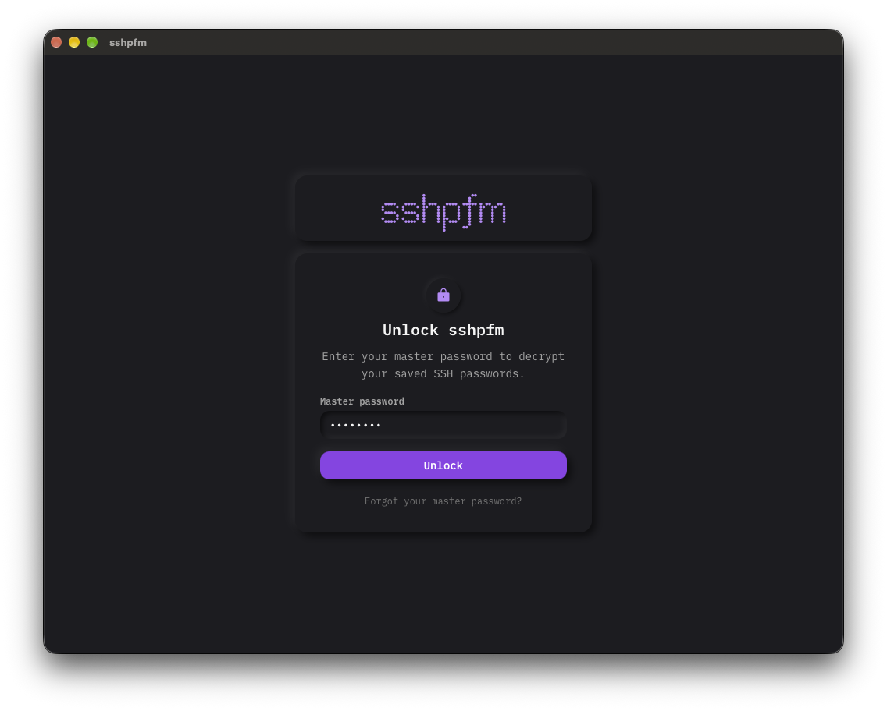
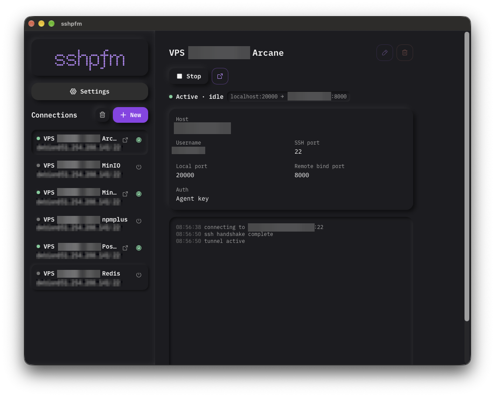
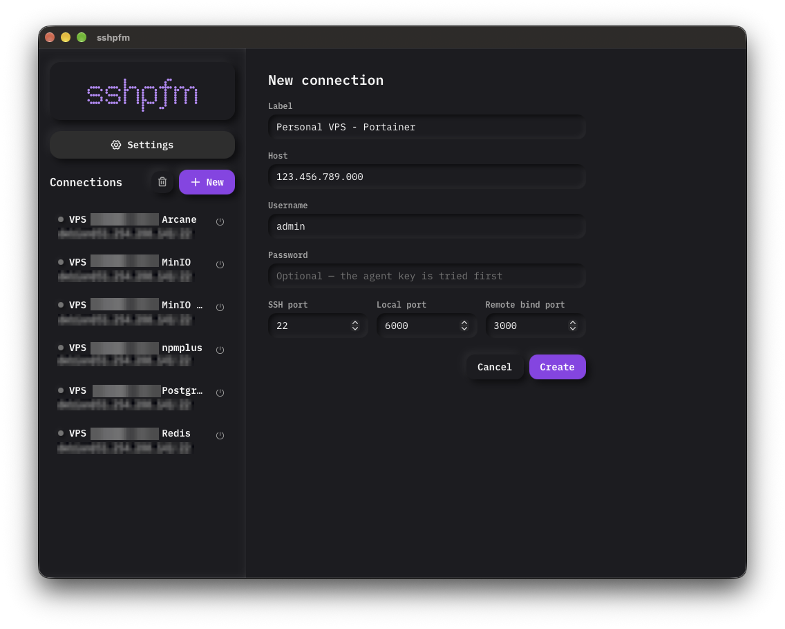
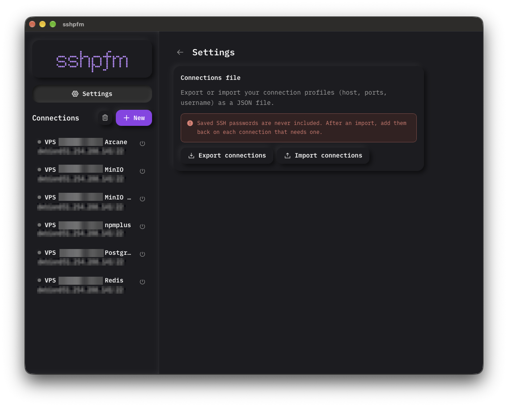

<p align="center">
  
</p>

<p align="center">
  A desktop app for configuring and managing SSH local port forwards.
</p>

---

`sshpfm` is a native macOS/Windows/Linux desktop app, built with [Wails](https://wails.io) (Go + Vue 3), for keeping a list of SSH local port-forward profiles and turning them on and off without typing `ssh -L` by hand. It authenticates through the [1Password SSH agent](https://developer.1password.com/docs/ssh/agent/) when available, falling back to a standard `ssh-agent`, and can optionally store a per-connection password, encrypted at rest.

> [!NOTE]
> This is a personal tool built for one workflow — local port forwarding through jump hosts — not a general-purpose SSH client.

## Screenshots

<p align="center">
  
  
</p>
<p align="center">
  
  
</p>

## Features

- **Connection profiles** — host, port, credentials, and one or more local→remote port forwards, persisted in a local SQLite database.
- **1Password / ssh-agent authentication** — signs with whichever agent it finds, in that order, with an override via `SSHPFM_AGENT_SOCK`.
- **Optional encrypted passwords** — a master password gates the app and derives the key that seals per-connection passwords with AES-256-GCM; the plaintext never touches disk or crosses into SQL by accident.
- **Trust-on-first-use host keys** — unknown or changed host keys prompt before a tunnel is opened, instead of failing silently or trusting blindly.
- **Live tunnel status and logs** — connect/disconnect from the sidebar, watch state changes and activity lines stream in per connection.
- **Import / export** — back up or move connection profiles between machines from the settings page.

## Getting started

### Prerequisites

- [Go](https://go.dev) 1.25+
- [Node.js](https://nodejs.org) 18+ and npm
- [Wails CLI v2](https://wails.io/docs/gettingstarted/installation)

### Run in development

```bash
make dev
```

This starts `wails dev`: a Vite dev server with hot reload for the frontend, and Go rebuilds on change. A browser-accessible dev server is also available at `http://localhost:34115` if you want DevTools access to the bound Go methods.

### Build

```bash
make build          # macOS universal .app (arm64 + x86_64), ad-hoc signed
make build-windows   # windows/amd64, with NSIS installer
make build-linux     # linux/amd64
make dmg             # package the macOS .app as a .dmg
```

Build artifacts land in `build/bin`. See the [Makefile](Makefile) for the full target list (`make help`).

> [!IMPORTANT]
> The macOS build is ad-hoc signed, not notarized. It runs fine locally, but a copy moved to another Mac needs right-click → Open, or a Developer ID signature.

### Checks

```bash
make check   # go vet ./..., go test ./..., vue-tsc --noEmit
```

## Architecture

Wails binds the methods on the `App` struct (`app.go`) to the frontend; TypeScript bindings are generated into `frontend/wailsjs/` and should not be hand-edited.

```
sshpfm/
├── app.go                 # Wails-bound App struct: connections, tunnels, vault
├── main.go                # window/app options, embedded assets
├── store/                 # SQLite persistence (modernc.org/sqlite, no cgo)
├── internal/
│   ├── sshauth/           # agent discovery + known_hosts / TOFU handling
│   ├── vault/             # Argon2id key derivation, AES-256-GCM sealing
│   └── tunnel/            # tunnel.Manager: dial, listen, pipe, keepalive, status
└── frontend/
    ├── src/                # Vue 3 app (App.vue, composables/, components/ui/)
    └── wailsjs/            # generated bindings — do not edit
```

**Password storage.** `vault.Derive` stretches the master password into 64 bytes: the first half is the AES key and stays in memory only, the second is the verifier stored in the `vault` table. The master password is required at every launch and gates the whole UI. `Store.Unlock` installs the key and all sealing/opening happens inside `store/`, so no caller can write a plaintext password to SQL by accident — `Password` is write-only, `HasPassword` is read-only, and every profile returned to the frontend is redacted.

**Agent discovery.** `internal/sshauth.FindAgent` checks `SSHPFM_AGENT_SOCK`, then the 1Password socket, then `SSH_AUTH_SOCK` last — on macOS the latter points at the launchd agent even when 1Password is installed, so it can't be checked first.

## Configuration

| What | Where |
| --- | --- |
| App name, version, copyright | [`wails.json`](wails.json) |
| Window size, theme, per-OS options | [`main.go`](main.go) |
| macOS bundle metadata | `build/darwin/Info.plist`, `Info.dev.plist` |
| Windows metadata / installer | `build/windows/` |
| App icon | `build/appicon.png` (regenerate with `make appicon` from `brand/logo-icon.png`) |
| SQLite database | `<user config dir>/sshpfm/sshpfm.db` |

## Tech stack

- **Backend:** Go, [Wails v2](https://wails.io), [modernc.org/sqlite](https://pkg.go.dev/modernc.org/sqlite) (pure Go, no cgo), `golang.org/x/crypto` for SSH and Argon2id
- **Frontend:** Vue 3 (Composition API), TypeScript, Tailwind CSS v4, [Phosphor Icons](https://phosphoricons.com)
